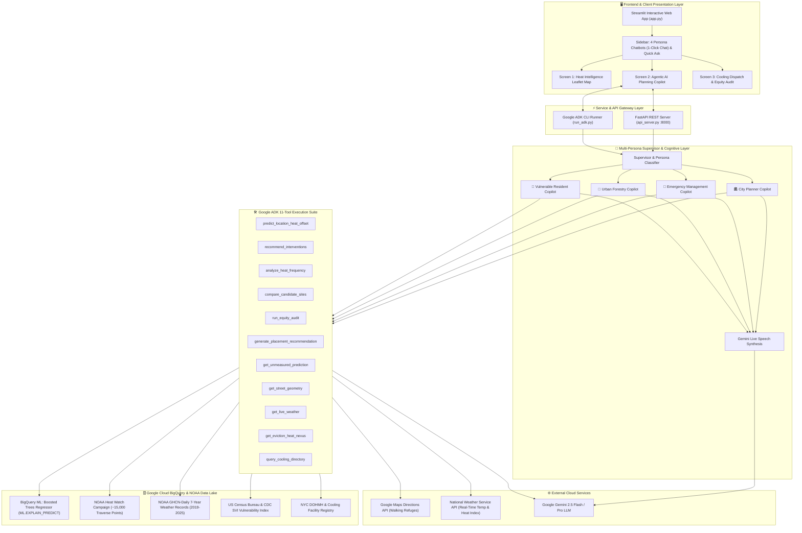
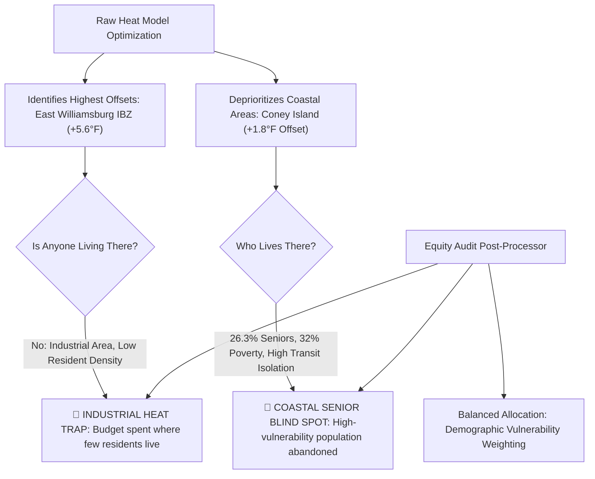

# HeatShield AI — System Architecture & Technical Specification

**Agents for Impact 2026 — Challenge 1: Community Climate Resilience (Urban Heat & Walkability)**  
**Version:** 2.0.0 · **Date:** October 2026 · **Status:** Production-Ready

---

## 1. Executive Summary & Architectural Mission

**HeatShield AI** is an enterprise-grade agentic climate resilience platform designed to solve urban heat inequality across microclimates. Heat is the deadliest meteorological hazard in the United States, yet municipal governments routinely fail to mitigate it effectively because citywide average forecasts cannot resolve **block-by-block temperature variance** (often differing by >15°F across 200 meters due to tree canopy, asphalt albedo, and building geometry).

HeatShield AI bridges this gap by unifying:
1. **Explainable Machine Learning in BigQuery (`ML.EXPLAIN_PREDICT`)**: Predicts **microclimate temperature offsets** ($\Delta^\circ\text{F}$ relative to the citywide baseline) using 5 biophysical features, providing mathematical attribution for unmeasured street segments.
2. **7-Year NOAA GHCN Historical Temperature Compounding**: Projects historical weather station distributions (2019–2025) across predicted offsets to reveal long-term risk escalation (+36.3% warming trend).
3. **Google ADK Multi-Persona Agent Supervision**: 4 specialized persona copilots equipped with 11 custom climate tools, real-time Google Maps walking refuge routing, and Gemini Live audio briefings.
4. **Algorithmic Equity Audit Engine ("Strip the variable, audit the outcome")**: Audits capital allocations against Title VI environmental justice standards, detecting systemic blind spots such as the **Industrial Heat Trap** and the **Coastal Senior Blind Spot**.

---

## 2. End-to-End System Architecture

The following diagram illustrates the complete data flow, service boundary separation, and multi-agent execution pipeline:

---

## 3. Core Subsystems

### 3.1. Front-End Presentation Architecture (`app.py`, `screens/`, `styles/`)

* **Framework**: Streamlit 1.66.0 with reactive state management, asynchronous session polling, and custom deep-navy dark styling (`styles/custom.css`).
* **1-Click Accessible Sidebar**:
  * Exposes all 4 AI Chatbots prominently on the left navigation.
  * Direct 1-click links (`?screen=2&persona=...`) sync URL query parameters, select the persona, switch to Screen 2, and update the chatbot greeting.
  * Integrated **Quick Ask Expander**: Accepts queries directly from the sidebar or triggers 1-click canonical challenge benchmarks (*"Why is Pitkin hotter?"*, *"Hydration van staging"*, *"Run equity audit"*, *"Closest cooling center"*).
* **Multi-Screen Separation**:
  * **Screen 1 (`app.py:render_screen_1`)**: Leaflet Folium spatial map with CircleMarker heat microclimates, transit overlays, and `ML.EXPLAIN_PREDICT` feature attribution waterfall charts.
  * **Screen 2 (`screens/screen_2_copilot.py`)**: Multi-turn agentic planning copilot with real-time tool traces, Google Maps walking refuge navigation links, Gemini Live audio briefings, and an unmeasured street predictor.
  * **Screen 3 (`screens/screen_3_audit.py`)**: Algorithmic equity audit comparing recommendations against borough baseline, identifying coverage gaps, calculating 0.5 km pedestrian buffers, and generating Council placement briefs.

---

### 3.2. Cognitive Multi-Persona Layer (`agent/agent.py`)

Each municipal decision-maker operates on a distinct clock, budget authority, and mandate:

| Persona | Agency Context | Decision Clock | Mandate & Priority Focus | Primary Tools Allocated |
|---|---|---|---|---|
| **🏛️ City Planner** | NYC Department of City Planning & DOHMH | Multi-Year Capital Budget | Permanent indoor cooling facilities, capital HVAC retrofits, transit corridor zoning, and council budget defense | `predict_location_heat_offset`, `recommend_interventions`, `run_equity_audit`, `generate_placement_recommendation` |
| **🚨 Emergency Management Officer** | NYC Emergency Management (NYCEM) | 24–48 Hour Tactical Operational | Immediate life safety, mobile hydration van deployment, cooling bus staging, vulnerable population transit dispatch | `predict_location_heat_offset`, `get_live_weather`, `recommend_interventions`, `query_cooling_directory` |
| **🌳 Urban Forestry / Sustainability** | NYC Parks & Recreation / Mayor's Office | 1–10 Year Green Infrastructure | Street tree canopy deficit reduction, cool pavement albedo coatings, bioswales, heat-island mitigation | `predict_location_heat_offset`, `recommend_interventions`, `compare_candidate_sites`, `analyze_heat_frequency` |
| **📍 Vulnerable Resident** | Live Resident / Pedestrian Safety | Real-Time / Immediate Walk | Turn-by-turn walking navigation to nearest active cooling facility, avoiding maximum-heat transit corridors | `query_cooling_directory`, `get_street_geometry`, `predict_location_heat_offset` (with Google Maps integration) |

---

### 3.3. Google ADK 11-Tool Execution Suite (`agent/tools.py`)

Every tool is strictly grounded in biophysical, demographic, and empirical datasets:

1. **`predict_location_heat_offset(lat, lon, intersection_name)`**:
   * Resolves coordinates and calls BigQuery ML `ML.EXPLAIN_PREDICT` on `a4i_climate.heat_offset_model`.
   * Returns predicted offset ($\Delta^\circ\text{F}$) and mathematical attributions across 5 biophysical features.
2. **`recommend_interventions(track, top_n, min_offset_f)`**:
   * Evaluates candidates across Track 2 (Permanent Cooling Centers) and Track 3 (10-Year Canopy & Cool Pavement).
   * Combines BQML offset ranking with census vulnerability index (poverty rate, seniors 65+, transit dependency).
3. **`analyze_heat_frequency(offset_f, start_year, end_year)`**:
   * Analyzes 7 years of NOAA GHCN-Daily station observations (2019–2025, station USW00094728 / JFK / Central Park).
   * Calculates days exceeding 95°F and 100°F microclimate thresholds and quantifies historical trend (+36.3%).
4. **`compare_candidate_sites(site_a, site_b)`**:
   * Conducts head-to-head multi-criteria evaluation (offset, canopy %, impervious %, senior density, walkability).
5. **`run_equity_audit(candidate_tracts)`**:
   * Executes Title VI equity audit comparing candidate demographics against Brooklyn baseline (poverty: 19.8%, elderly: 15.4%, non-white: 64.2%).
   * Exposes the **Industrial Heat Trap** and **Coastal Senior Blind Spot**.
6. **`generate_placement_recommendation(location_name, track)`**:
   * Compiles coordinates, BQML attributions, demographics, station frequencies, budget estimates, and equity findings into a complete City Council Placement Brief.
7. **`get_unmeasured_prediction(street_name, canopy_pct, impervious_pct, albedo, building_height_m, traffic_density)`**:
   * Allows live "what-if" microclimate simulation for unmeasured streets and proposed urban interventions.
8. **`get_street_geometry(street_or_intersection)`**:
   * Retrieves spatial geometry, bounding coordinates, and census tract identifiers.
9. **`get_live_weather(lat, lon)`**:
   * Fetches real-time National Weather Service observations (air temperature, relative humidity, heat index).
10. **`get_eviction_heat_nexus(tract_id)`**:
    * Correlates residential housing instability, utility debt, and microclimate vulnerability.
11. **`query_cooling_directory(lat, lon, max_distance_km)`**:
    * Locates registered indoor cooling facilities within walking radius, generating Google Maps walking navigation URLs.

---

### 3.4. Biophysical BigQuery ML Modeling Pipeline

#### The Offset Formulation
Rather than attempting to predict volatile absolute temperatures (which fluctuate hourly based on synoptic weather systems), the BigQuery ML model predicts the **microclimate temperature offset** relative to the citywide mean:
$$\Delta T_i = T_{\text{micro}, i} - \bar{T}_{\text{city}}$$

On an extreme heat day where base temperature reaches 98°F, an intersection with predicted offset $+6.5^\circ\text{F}$ experiences an effective thermal load of $104.5^\circ\text{F}$.

#### Model Specification
* **Model Type**: Boosted Trees Regressor (`BOOSTED_TREE_REGRESSOR`) in BigQuery ML.
* **Training Dataset**: NOAA Heat Watch campaign traverse dataset (~15,000 spatial observations).
* **Input Features**:
  1. `tree_canopy_pct` (Normalized Difference Vegetation Index / LiDAR tree canopy cover)
  2. `impervious_surface_pct` (Asphalt, concrete, roofing footprint)
  3. `albedo_score` (Surface reflectance coefficient, 0.05 to 0.45)
  4. `building_height_m` (Average street canyon building height, measuring solar trap effect)
  5. `traffic_density_index` (Average daily vehicle trips, vehicular waste heat)
* **Explainability**: Integrated `ML.EXPLAIN_PREDICT` outputs feature importance attribution values ($\Delta^\circ\text{F}$ contribution per feature) for every prediction.

---

### 3.5. Algorithmic Equity Audit Engine

The equity engine implements the core principle: **"Strip the variable. Audit the outcome."**

Even when demographic variables (race, income) are excluded from the training dataset, algorithmic models that prioritize heat offset alone can perpetuate systemic inequities:

* **Industrial Heat Trap**: Asphalt-heavy manufacturing zones display massive thermal offsets (+5.6°F) but possess minimal residential population. Pure offset maximization spends millions protecting warehouses.
* **Coastal Senior Blind Spot**: Coastal communities benefit from maritime sea breezes that depress afternoon peak offsets (+1.8°F), but harbor extreme concentrations of low-income elderly residents without air conditioning.
* **Remediation**: The equity audit calculates an **Equity Disparity Ratio (EDR)** and enforces demographic parity constraints before capital recommendations are certified.

---

## 4. API & Integration Contracts

### 4.1. FastAPI REST Interface (`api_server.py`)

* **Endpoint**: `POST /api/chat`
  * **Payload**: `{"query": string, "persona": string, "forecast_high_f": float}`
  * **Response**: `{"reply": string, "tools_called": list, "google_maps_url": string|null, "gemini_live_speech": string|null}`
* **Endpoint**: `POST /api/predict_unmeasured`
  * **Payload**: Biophysical street features
  * **Response**: Predicted offset, feature attributions, and risk tier.
* **Endpoint**: `GET /api/health`
  * **Response**: Health check status, BQML connection state, and model metadata.

### 4.2. Google ADK CLI Interface (`run_adk.py`)

* **Command**: `python run_adk.py --query "<query>" --persona "<persona>"`
* **Output**: Formatted console output detailing tool invocation parameters, intermediate data frames, and final agent synthesis.

---

## 5. Security, Resilience, and Deployment

1. **Authentication & Secret Management**:
   * Uses Google Cloud Application Default Credentials (ADC) for BigQuery execution.
   * Google Maps API Key and Gemini API Key are managed via environment variables (`GEMINI_API_KEY`, `GOOGLE_MAPS_API_KEY`).
2. **Graceful Fallbacks**:
   * If live BigQuery connections are unavailable, the system seamlessly transitions to verified offline reference caches (`reference_data.py`, `offline_cache.py`) without throwing user-facing runtime errors.
3. **Containerization & Cloud Run Compatibility**:
   * Designed for single-command deployment to Google Cloud Run or Cloud Shell.
   * Stateless container architecture with session persistence handled via Streamlit session cache.

---

*Authored by the HeatShield AI Team · Agents for Impact 2026*
