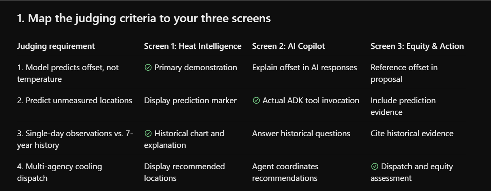

# Challenge 1—Community Climate Resilience: Urban Heat

**Agents for Impact 2026**

---

## Why this one matters

Screen 1 — Heat Intelligence & Microclimate Map
Purpose: Show where heat exposure differs across Brooklyn.

Features:
- **Decision Persona Selector (Sidebar)**: Switch dynamically between City Planner, Emergency Management Officer, and Sustainability / Urban Forestry Officer.
- **Top Executive Focus Card**: Prominently displays the active operational focus, lead agency mandate, and dynamic map scale pill.
- **Dynamic KPI Cards & Priority Ranking**: Tailored metrics and table sort orders adapted to the chosen persona's key goals.
- **Interactive Leaflet Map**: Dynamic zoom levels and centroid focus (11.5x Boroughwide Siting, 13.8x Acute Hotspot Dispatch, 12.6x Tree Canopy & Corridor Albedo View), predicted heat-offset markers, and 0.5 km cooling catchment rings.
- **Forecast Scenario Slider & Detail Panel**: Interactive base temperature adjustment, intersection intelligence, and seven-year GHCN station history.

Allow users to select an unmeasured street location and pass its coordinates to the AI Copilot.
Screen 2 — Agentic AI Planning Copilot
Purpose: Demonstrate real ADK agent execution.

Include chat, suggested questions, agent execution timeline, tool invocation evidence, unmeasured-location predictions, and ranked recommendations.

Make the custom predict_location_heat_offset() tool call clearly visible.
Screen 3 — Government Cooling Dispatch & Equity Audit
Purpose: Convert AI recommendations into actionable interventions.

Include recommended dispatch locations, agency assignments, approximate coverage rings, equity gaps, ML.EXPLAIN_PREDICT explanations, and a downloadable action proposal.

