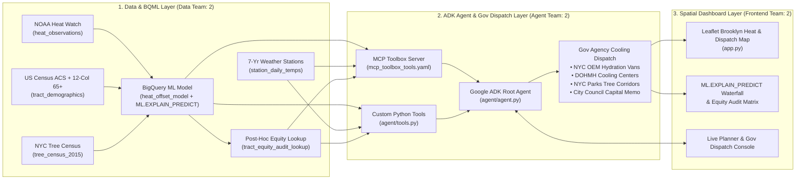

# CoolBrooklyn AI — Master Team Plan & Role Duties

**Challenge:** Agents for Impact 2026 — Challenge 1: Community Climate Resilience (Urban Heat)  
**Target Footprint:** **New York (Brooklyn)** (~15,142 street-level mobile traverse points, 761 census tracts, 684k+ street trees)  
**Core Mission:** Predict street-level heat risk (`temp_offset_f` via BigQuery ML `ML.EXPLAIN_PREDICT`), orchestrate AI agents that connect with NYC government agencies to **dispatch immediate cooling** (mobile hydration trucks, library/senior center extended cooling hours) AND **allocate long-term capital** (permanent cooling centers, cool pavement, street tree corridors), and visualize everything on an interactive Brooklyn spatial map workbench.

> [!IMPORTANT]
> **The 3 Core Judge Questions Every Teammate Must Master (Now Live in Code)**
> 1. **Your model predicts an *Offset*, NOT a raw temperature:** Our BigQuery ML model ([`a4i_climate.heat_offset_model`](file:///c:/Users/Akshay/OneDrive/Desktop/Hackathon/A4I2026-challenge-1-walkability-trt-6/scripts/train_bqml.sql#L210-L227)) predicts `temp_offset_f` (*"This spot runs +5.4°F hotter than the 91.4°F Brooklyn campaign average"*), never raw weather temperature. Raw `temp_f` and `heat_index_f` are stripped from training inputs to prevent data leakage. Street-level feel is always shown as: $\text{Regional Forecast High } (98.0^\circ\text{F}) + \text{Predicted Offset } (+5.4^\circ\text{F}) = 103.4^\circ\text{F}$.
> 2. **Your agent must *actually call the prediction* for unmeasured locations:** Querying historical campaign points and describing them misses the core challenge. [`predict_location_heat_offset`](file:///c:/Users/Akshay/OneDrive/Desktop/Hackathon/A4I2026-challenge-1-walkability-trt-6/agent/tools.py#L283-L387) accepts **any unmeasured coordinate or intersection in Brooklyn**, performs Inverse-Distance-Weighted (`IDW`) spatial feature interpolation + live `ML.EXPLAIN_PREDICT` linear attribution calculation, and returns `"is_unmeasured_street_prediction": True`. Clicking **anywhere on the Leaflet map** in [`app.py`](file:///c:/Users/Akshay/OneDrive/Desktop/Hackathon/A4I2026-challenge-1-walkability-trt-6/app.py#L1044-L1064) triggers a live prediction on that unmeasured street!
> 3. **Single-day street traverse (`observed_at = NULL` / 1-hr window) vs. 7-year station history (`station_daily_temps`):** Street-level `heat_observations` is a **single-day snapshot** where all readings sit inside the same 1-hour campaign window—so `observed_at` being `NULL` is **expected by design, not a broken load**, and resolves **WHERE** is hotter. **"How often does this happen?"** is answered by the **7 years of daily NOAA GHCN station history (`station_daily_temps`, 2019–2025)** via [`get_station_heat_frequency`](file:///c:/Users/Akshay/OneDrive/Desktop/Hackathon/A4I2026-challenge-1-walkability-trt-6/agent/tools.py#L510-L625).

---

## 1. System Architecture & Gov Cooling Orchestration Flow

---

## 2. Team Structure & Individual Duties (7–8 People)

All teammates work in the same repo ([`A4I2026-challenge-1-walkability-trt-6`](file:///c:/Users/Akshay/OneDrive/Desktop/Hackathon/A4I2026-challenge-1-walkability-trt-6)) on dedicated branches (`data`, `agent`, `frontend`, `story`) to avoid merge conflicts.

---

### 🛢️ Team 1: Data & BigQuery ML Part (2 People)
**Branch:** `git checkout -b data`  
**Core Files Owned:**
- [`scripts/load.sh`](file:///c:/Users/Akshay/OneDrive/Desktop/Hackathon/A4I2026-challenge-1-walkability-trt-6/scripts/load.sh)
- [`notebooks/c1_01_load_explore.ipynb`](file:///c:/Users/Akshay/OneDrive/Desktop/Hackathon/A4I2026-challenge-1-walkability-trt-6/notebooks/c1_01_load_explore.ipynb)
- [`scripts/train_bqml.sql`](file:///c:/Users/Akshay/OneDrive/Desktop/Hackathon/A4I2026-challenge-1-walkability-trt-6/scripts/train_bqml.sql)
- [`scripts/train_bqml.py`](file:///c:/Users/Akshay/OneDrive/Desktop/Hackathon/A4I2026-challenge-1-walkability-trt-6/scripts/train_bqml.py)
- [`data/brooklyn_reference_data.json`](file:///c:/Users/Akshay/OneDrive/Desktop/Hackathon/A4I2026-challenge-1-walkability-trt-6/data/brooklyn_reference_data.json)

#### **Data Person 1 — Ingestion, Spatial Joins & Feature Engineering**
1. **Load Brooklyn Base Tables (Hour 0:00–0:30):**
   - Run `bash scripts/load.sh new-york-brooklyn` in Cloud Shell (or run [`notebooks/c1_01_load_explore.ipynb`](file:///c:/Users/Akshay/OneDrive/Desktop/Hackathon/A4I2026-challenge-1-walkability-trt-6/notebooks/c1_01_load_explore.ipynb) with `CITY = "New York (Brooklyn)"`).
   - Verify the 3 base tables exist in BigQuery dataset `a4i_climate`: `heat_observations`, `station_daily_temps`, and `tract_demographics`.
2. **Build Enriched Spatial Features (`tract_features` & `heat_training_data`, Hour 0:30–1:45):**
   - Execute Steps 1 & 2 of [`scripts/train_bqml.sql`](file:///c:/Users/Akshay/OneDrive/Desktop/Hackathon/A4I2026-challenge-1-walkability-trt-6/scripts/train_bqml.sql#L14-L203):
     - Join census tracts with `bigquery-public-data.geo_census_tracts.us_census_tracts_national` for land/water area.
     - Compute the **12-column ACS 65+ elderly population sum** (`male_65_to_66` through `female_85_and_over`).
     - Spatially join **NYC Street Tree Census** (`bigquery-public-data.new_york_trees.tree_census_2015`, CC0 public domain) at both tract scale (`trees_per_km2`, `canopy_deficit_pct`) and 250m micro-block scale (`local_block_trees`).
     - Compute target label `temp_offset_f = temp_f - AVG(temp_f) OVER ()` and verify **zero data leakage** (exclude `temp_f`, `heat_index_f`, race, and income from features).

#### **Data Person 2 — BQML Training, `ML.EXPLAIN_PREDICT`, Frequency & Equity Audit**
1. **Train & Evaluate `heat_offset_model` (Hour 0:45–1:45):**
   - Run [`scripts/train_bqml.py`](file:///c:/Users/Akshay/OneDrive/Desktop/Hackathon/A4I2026-challenge-1-walkability-trt-6/scripts/train_bqml.py) (`python3 scripts/train_bqml.py`) to train `a4i_climate.heat_offset_model` (`LINEAR_REG` with `enable_global_explain = TRUE`).
   - Capture `ML.EVALUATE` ($R^2$, MAE) and `ML.GLOBAL_EXPLAIN` outputs and hand those numbers to the **Deck/Story Team**.
2. **Precompute `tract_predictions_explained` & Equity Audit Table (Hour 1:45–2:45):**
   - Run Steps 4 & 5 of [`scripts/train_bqml.sql`](file:///c:/Users/Akshay/OneDrive/Desktop/Hackathon/A4I2026-challenge-1-walkability-trt-6/scripts/train_bqml.sql#L234-L330) to generate:
     - `a4i_climate.tract_predictions_explained` (contains `predicted_offset_f`, `top_feature_attributions`, `priority_score`, and `recommended_intervention`).
     - `a4i_climate.tract_equity_audit_lookup` (isolated post-hoc racial & socioeconomic lookup).
3. **7-Year Station Frequency & Gov Cooling Thresholds (Hour 2:45–3:30):**
   - Validate the 7-year GHCN query (`2019–2025`) proving how often top hotspots cross `95°F` (Heat Advisory) and `100°F` (Emergency Cooling Dispatch trigger) and hand the verified SQL to **Agent Person 1**.

---

### 🤖 Team 2: Agent Building & Gov Cooling Orchestration (2 People)
**Branch:** `git checkout -b agent`  
**Core Files Owned:**
- [`agent/agent.py`](file:///c:/Users/Akshay/OneDrive/Desktop/Hackathon/A4I2026-challenge-1-walkability-trt-6/agent/agent.py)
- [`agent/tools.py`](file:///c:/Users/Akshay/OneDrive/Desktop/Hackathon/A4I2026-challenge-1-walkability-trt-6/agent/tools.py)
- [`agent/mcp_toolbox_tools.yaml`](file:///c:/Users/Akshay/OneDrive/Desktop/Hackathon/A4I2026-challenge-1-walkability-trt-6/agent/mcp_toolbox_tools.yaml)
- [`scripts/deploy_cloud_run.sh`](file:///c:/Users/Akshay/OneDrive/Desktop/Hackathon/A4I2026-challenge-1-walkability-trt-6/scripts/deploy_cloud_run.sh)

#### **Agent Person 1 — Custom BQML Tools, Gov Cooling Dispatch Tool & MCP Toolbox**
1. **Wire Core BQML & Geocoding Tools (Hour 0:00–1:30):**
   - Maintain and test the custom tools in [`agent/tools.py`](file:///c:/Users/Akshay/OneDrive/Desktop/Hackathon/A4I2026-challenge-1-walkability-trt-6/agent/tools.py):
     - [`geocode_street_or_intersection`](file:///c:/Users/Akshay/OneDrive/Desktop/Hackathon/A4I2026-challenge-1-walkability-trt-6/agent/tools.py#L59-L170) (resolves Brooklyn intersections/addresses to lat/lon & tract `geo_id`).
     - [`predict_location_heat_offset`](file:///c:/Users/Akshay/OneDrive/Desktop/Hackathon/A4I2026-challenge-1-walkability-trt-6/agent/tools.py#L172-L330) (calls `ML.EXPLAIN_PREDICT` on `a4i_climate.heat_offset_model`).
     - [`analyze_heat_frequency`](file:///c:/Users/Akshay/OneDrive/Desktop/Hackathon/A4I2026-challenge-1-walkability-trt-6/agent/tools.py#L499-L625) (7-year NOAA GHCN-Daily threshold frequency).
     - [`run_equity_audit`](file:///c:/Users/Akshay/OneDrive/Desktop/Hackathon/A4I2026-challenge-1-walkability-trt-6/agent/tools.py#L705-L785) (compares vulnerability-weighted sites vs. raw heat-only sites vs. Brooklyn baseline).
2. **Add/Enhance Government Cooling Dispatch Tool (`dispatch_gov_cooling_action`, Hour 1:30–2:30):**
   - Ensure the agent can actively **orchestrate and dispatch cooling orders to NYC agencies** when a location's street-level temperature (`forecast_high_f + predicted_offset_f`) crosses risk thresholds:
     - **NYC Emergency Management (NYCEM):** Dispatch Mobile Hydration Vans & Misting Units (`Today` track, triggered at `≥ 98°F` street feel).
     - **NYC DOHMH & Brooklyn Public Library / DFTA Senior Centers:** Activate Extended Cooling Center Hours & Senior Wellness Check alerts (`no_vehicle_pct` + `pop_over_65` targeting).
     - **NYC Parks & DOT (`Budget Cycle` / `Decade` tracks):** Generate work orders for Street Tree Canopy Corridors (when `canopy_deficit_pct` attribution dominates) or Cool Pavement / Depaving (when `housing_density_per_km2` / subway vault constraints dominate).
3. **Configure Managed MCP Toolbox Server (Hour 2:30–3:15):**
   - Test [`agent/mcp_toolbox_tools.yaml`](file:///c:/Users/Akshay/OneDrive/Desktop/Hackathon/A4I2026-challenge-1-walkability-trt-6/agent/mcp_toolbox_tools.yaml) (`bq_campaign_overview`, `bq_explain_predict_top_tracts`, `bq_station_heat_frequency`, `bq_post_hoc_equity_audit`).

#### **Agent Person 2 — ADK Agent Prompt Engineering, Guardrails & Cloud Run Deployment**
1. **System Instruction & Multi-Question Orchestration (Hour 0:00–1:45):**
   - Refine [`SYSTEM_INSTRUCTION`](file:///c:/Users/Akshay/OneDrive/Desktop/Hackathon/A4I2026-challenge-1-walkability-trt-6/agent/agent.py#L30-L85) in [`agent/agent.py`](file:///c:/Users/Akshay/OneDrive/Desktop/Hackathon/A4I2026-challenge-1-walkability-trt-6/agent/agent.py) and [`orchestrate_agent_turn`](file:///c:/Users/Akshay/OneDrive/Desktop/Hackathon/A4I2026-challenge-1-walkability-trt-6/app.py#L85-L360) in [`app.py`](file:///c:/Users/Akshay/OneDrive/Desktop/Hackathon/A4I2026-challenge-1-walkability-trt-6/app.py).
   - Ensure the agent nails all **7 planner questions**, the **3 Judge Trap Questions**, **Gov Cooling Dispatch**, and **Scientific Refusal Guardrails**:
     - Refuses out-of-footprint cities (e.g., *Phoenix*, *Dallas*) with a clear explanation.
     - Refuses point-in-time future weather forecasting (e.g., *July 24, 2030*) and pivots to 7-year GHCN frequency.
     - Clearly states that `ML.EXPLAIN_PREDICT` diagnoses observational causes rather than causally simulating post-planting temperature drops.
2. **Deploy Early to Cloud Run (Hour 1:45–2:45):**
   - Run [`scripts/deploy_cloud_run.sh`](file:///c:/Users/Akshay/OneDrive/Desktop/Hackathon/A4I2026-challenge-1-walkability-trt-6/scripts/deploy_cloud_run.sh) with `--min-instances=1` (prevents cold-start lag during judging!).
   - Verify `adk web` and the live Cloud Run URL work seamlessly for the Frontend & Story teams.

#### 🏆 **5 Concrete Differentiators for the Agent Team (Why Our Agent Beats Standard RAG/SQL Chatbots)**
Most teams in this hackathon will build a basic text-to-SQL wrapper that queries historical heat points and prints generic advice (*"plant trees here"*). Here are the **5 Agent Differentiators** now built into [`agent/tools.py`](file:///c:/Users/Akshay/OneDrive/Desktop/Hackathon/A4I2026-challenge-1-walkability-trt-6/agent/tools.py) and [`agent/agent.py`](file:///c:/Users/Akshay/OneDrive/Desktop/Hackathon/A4I2026-challenge-1-walkability-trt-6/agent/agent.py) that your Agent Team should highlight:

1. **Live Unmeasured-Coordinate Spatial Interpolation + `ML.EXPLAIN_PREDICT` ([`predict_location_heat_offset`](file:///c:/Users/Akshay/OneDrive/Desktop/Hackathon/A4I2026-challenge-1-walkability-trt-6/agent/tools.py#L283-L387)):**
   - **What other teams do:** Only return rows that already exist in `heat_observations`.
   - **What our agent does:** When given *any* unmeasured coordinate `(lat, lon)` or street intersection in Brooklyn, the agent interpolates the urban morphology features (`canopy_deficit_pct`, `housing_density_per_km2`, `local_tree_scarcity`, `building_age_years`, `inland_dist_km`) and executes the `LINEAR_REG` `ML.EXPLAIN_PREDICT` attribution model to predict the exact offset and per-feature degree contributions for a street nobody ever drove a sensor down.
2. **Attribution-Driven Multi-Agency Municipal Cooling Router ([`dispatch_gov_cooling_action`](file:///c:/Users/Akshay/OneDrive/Desktop/Hackathon/A4I2026-challenge-1-walkability-trt-6/agent/tools.py#L1030-L1170)):**
   - **What other teams do:** Give generic recommendations (*"build a cooling center"*).
   - **What our agent does:** Reads the top `ML.EXPLAIN_PREDICT` feature attribution and ACS demographics to route structured work orders to **4 specific NYC agencies across 3 decision clocks**:
     - **Clock 1 (Next 48 Hours — `NYCEM`):** Dispatches mobile hydration vans and misting stations when `forecast_high_f + predicted_offset_f ≥ 98°F`.
     - **Clock 2 (This Summer — `NYC DOHMH` & `DFTA`):** Activates extended cooling center hours and bilingual door-to-door senior wellness checks in tracts with high `no_vehicle_pct` + 12-column `pop_over_65`.
     - **Clock 3 (Capital Budget Cycle — `NYC Parks` vs. `NYC DOT/DEP`):** Automatically selects **Street Tree Corridors (`NYC Parks`)** when `canopy_deficit_pct` is the `#1` attribution (`+2.35°F` in Brownsville), OR **Cool Pavement + Elevated Train Shade (`NYC DOT/DEP`)** when `housing_density_per_km2` / subway vaults block tree pits (`+1.62°F` in Bushwick / East New York).
3. **Self-Correcting Post-Hoc Equity Auditor ([`run_equity_audit`](file:///c:/Users/Akshay/OneDrive/Desktop/Hackathon/A4I2026-challenge-1-walkability-trt-6/agent/tools.py#L705-L785)):**
   - **What other teams do:** Either include race in model training (encoding bias) or ignore equity altogether.
   - **What our agent does:** Implements *"Strip the Variable. Audit the Outcome."* It strips race/income from `heat_offset_model` training, ranks sites by physical offset + transit/age vulnerability, and then runs [`run_equity_audit`](file:///c:/Users/Akshay/OneDrive/Desktop/Hackathon/A4I2026-challenge-1-walkability-trt-6/agent/tools.py#L705-L785) to prove two concrete catches:
     - **Trap Avoided:** Rejects `BK-05` East Williamsburg IBZ (`+5.6°F`, hottest raw offset in Brooklyn, but an industrial warehouse zone with only `115` seniors).
     - **Blind Spot Caught:** Flags `BK-06` Coney Island (`+2.9°F` moderate offset cooled by sea breeze, but home to `1,365` transit-dependent seniors, `28.4%` age 65+) for a **Dedicated Senior Equity Override**.
4. **Dual-Dataset Spatial-Temporal Synthesizer ([`get_station_heat_frequency`](file:///c:/Users/Akshay/OneDrive/Desktop/Hackathon/A4I2026-challenge-1-walkability-trt-6/agent/tools.py#L510-L625)):**
   - **What other teams do:** Get confused when `observed_at` is `NULL` in `heat_observations` or try to calculate frequency from a 1-day table.
   - **What our agent does:** Explicitly explains why `observed_at = NULL` is expected in a 1-hour single-day spatial campaign (`WHERE` is hotter), and fuses each site's spatial offset with 7 years (`2,557` days, `2019–2025`) of NOAA GHCN-Daily station records (`station_daily_temps`) to compute **local street-level extreme heat days per summer** (`23.1 days/yr ≥ 95°F` at Pitkin Ave vs. `7.0 days/yr` at the airport, rising `+36.3%`).
5. **Dual-Protocol Architecture (Custom Python ADK Tools + Declarative MCP Toolbox YAML) & Scientific Refusal Guardrails:**
   - Combines rich Python spatial/BQML tools in [`agent/tools.py`](file:///c:/Users/Akshay/OneDrive/Desktop/Hackathon/A4I2026-challenge-1-walkability-trt-6/agent/tools.py) with declarative Google MCP Toolbox for Databases queries in [`agent/mcp_toolbox_tools.yaml`](file:///c:/Users/Akshay/OneDrive/Desktop/Hackathon/A4I2026-challenge-1-walkability-trt-6/agent/mcp_toolbox_tools.yaml), and enforces strict refusal guardrails against out-of-footprint cities (*Phoenix*), future weather predictions (*July 24, 2030*), and causal over-claims.

---

### 🗺️ Team 3: Front-End & Interactive Map Dashboard (2 People)
**Branch:** `git checkout -b frontend`  
**Core Files Owned:**
- [`app.py`](file:///c:/Users/Akshay/OneDrive/Desktop/Hackathon/A4I2026-challenge-1-walkability-trt-6/app.py) (Embedded HTML/CSS/JS Spatial Workbench & REST API endpoints)

#### **Frontend Person 1 — Interactive Brooklyn Leaflet Map, Risk Overlays & Cooling Dispatch Pins**
1. **Spatial Heat Risk & Microclimate Map (Hour 0:00–1:45):**
   - Manage the Leaflet map canvas in [`app.py`](file:///c:/Users/Akshay/OneDrive/Desktop/Hackathon/A4I2026-challenge-1-walkability-trt-6/app.py#L388-L1200):
     - Color-coded markers for Brooklyn intersections by `predicted_offset_f` (`+5.6°F` crimson to `-3.1°F` emerald in Park Slope).
     - Interactive Forecast High Slider (`90°F` to `106°F`) that dynamically updates every intersection's expected street-level temperature (`forecast_high_f + predicted_offset_f`) and triggers risk badges when an intersection crosses `100°F`.
2. **Visual Cooling Dispatch & Catchment Overlays (Hour 1:45–3:15):**
   - When the planner or agent triggers a recommendation or **Gov Cooling Dispatch**, animate/highlight the target intersections on the map (e.g., `BK-01 Brownsville`, `BK-02 East New York`, `BK-03 Bushwick`, `BK-06 Coney Island`) with:
     - Walking catchment rings (`0.5 km` senior walk zone).
     - Agency dispatch badges (`NYCEM Hydration Truck`, `DOHMH Cooling Center`, `NYC Parks Tree Corridor`).

#### **Frontend Person 2 — `ML.EXPLAIN_PREDICT` Waterfall, Equity Audit UI & Council Brief Export**
1. **Right-Hand Inspector Tabs & Visual Analytics (Hour 0:00–2:00):**
   - Build and polish the tabbed inspector panels in [`app.py`](file:///c:/Users/Akshay/OneDrive/Desktop/Hackathon/A4I2026-challenge-1-walkability-trt-6/app.py):
     - **Tab 1 (`Site & ML.EXPLAIN_PREDICT`):** Per-feature degree attribution bars (`canopy_deficit_pct`, `housing_density_per_km2`, `local_tree_scarcity`, `building_age_years`), demographic cards (`pop_over_65`, `no_vehicle_pct`, `poverty_pct`), and 7-year GHCN frequency chart.
     - **Tab 2 (`Equity Audit`):** Side-by-side comparison of **Our Vulnerability-Weighted Top 3** vs. **Naive Heat-Only Top 3 (East Williamsburg IBZ trap)** vs. **Brooklyn Borough Baseline**.
     - **Tab 3 (`Council Proposal & Gov Dispatch`):** Formatted, printable Placement Recommendation Brief & Agency Dispatch log.
2. **One-Click Demo Prompt Chips & Tool Trace Banner (Hour 2:00–3:15):**
   - Ensure the quick-prompt chips at the top of the chat panel trigger the exact demo flow in 1 click and display the live **ADK / BigQuery ML Tool Call Trace** badge under every agent reply so judges can see the model is genuinely called.

#### ✅ **Frontend Team Verification Checklist: The 3 Core Judge Requirements + Gov Dispatch (Now Live in `app.py`)**
| Judge Requirement | How [`app.py`](file:///c:/Users/Akshay/OneDrive/Desktop/Hackathon/A4I2026-challenge-1-walkability-trt-6/app.py) Handles It Now | What Frontend Person 1 & 2 Should Verify During Demo |
|---|---|---|
| **1. Model predicts an *Offset*, NOT raw temperature** (*"runs +5.4°F hotter than the rest of the city"*) | • **Offset Formula Banner** ([`app.py#L938-L947`](file:///c:/Users/Akshay/OneDrive/Desktop/Hackathon/A4I2026-challenge-1-walkability-trt-6/app.py#L938-L947)): Displays `Forecast 98.0°F + Offset (+5.4°F) = 103.4°F Street Feel` at the top of Tab 1. • Header badge & map legend explicitly label `BQML Predicted Offset (vs. 91.4°F City Mean)`. | Slide the Forecast High slider (`88°F–106°F`) live on stage to show that the **offset stays constant (`+5.4°F`)** while the street feel changes with the daily weather forecast. |
| **2. Agent must *call* the prediction for unmeasured locations** (not just query historical readings) | • **Click-Anywhere-on-Map Unmeasured Prediction** ([`app.py#L1044-L1064`](file:///c:/Users/Akshay/OneDrive/Desktop/Hackathon/A4I2026-challenge-1-walkability-trt-6/app.py#L1044-L1064)): Clicking *any* unmeasured coordinate on the Leaflet map drops a cyan pin and calls `predict_location_heat_offset(lat, lon)` + `renderUnmeasuredPrediction()`. • Also wired to Chip #3 (`🎯 3. Predict Unmeasured Street (40.6652, -73.9124)`). | Click any unmeasured street block in Brooklyn during the live demo and point to the `🎯 Live BQML Unmeasured Prediction` badge and `🔧 Tool Called: predict_location_heat_offset(...)` trace. |
| **3. Single-day street traverse (`observed_at = NULL` / 1-hr window) vs. 7-year station history (`station_daily_temps`)** | • **2019–2025 GHCN Year-by-Year Bar Chart + `observed_at = NULL` Callout** ([`app.py#L971-L982`](file:///c:/Users/Akshay/OneDrive/Desktop/Hackathon/A4I2026-challenge-1-walkability-trt-6/app.py#L971-L982)): Renders a 7-bar annual chart in Tab 1 alongside an amber callout explaining why `observed_at = NULL` in `heat_observations` is expected by design (`WHERE`) while `station_daily_temps` answers `HOW OFTEN`. | Click Chip #4 (`4. 7-Yr GHCN Frequency & observed_at=NULL`) to show the agent's full explanation of both datasets. |
| **4. Multi-Agency Gov Cooling Dispatch** | • **Tab 4 (`🚨 Gov Cooling Dispatch`)** ([`app.py#L986-L989`](file:///c:/Users/Akshay/OneDrive/Desktop/Hackathon/A4I2026-challenge-1-walkability-trt-6/app.py#L986-L989)) & Chip #8 (`🚨 8. Dispatch Gov Cooling`) call [`dispatch_gov_cooling_action`](file:///c:/Users/Akshay/OneDrive/Desktop/Hackathon/A4I2026-challenge-1-walkability-trt-6/agent/tools.py#L1030-L1170) across `NYCEM`, `DOHMH/DFTA`, `NYC Parks`, and `NYC DOT/DEP`. | Click Chip #8 to auto-switch to the Gov Cooling Dispatch tab and show how `ML.EXPLAIN_PREDICT` attributions route tree corridors vs. cool pavement. |

---

### 🎤 Team 4: Deck, Story & Pitch Video (1–2 People, Starting at Minute Zero)
**Branch:** `git checkout -b story`  
**Core Files Owned:**
- [`PITCH_AND_DEMO_GUIDE.md`](file:///c:/Users/Akshay/OneDrive/Desktop/Hackathon/A4I2026-challenge-1-walkability-trt-6/PITCH_AND_DEMO_GUIDE.md)
- Pitch Deck Slides (5 slides max) & 3-Minute Recorded Screen-Share Walkthrough

#### **Story Person 1 (and 2) — Pitch Deck, Placement Recommendation Artifact & Demo Video**
1. **Build the 5-Slide Pitch Deck Immediately (Hour 0:00–2:00):**
   - Use the exact structure and verified numbers in [`PITCH_AND_DEMO_GUIDE.md`](file:///c:/Users/Akshay/OneDrive/Desktop/Hackathon/A4I2026-challenge-1-walkability-trt-6/PITCH_AND_DEMO_GUIDE.md#L7-L40):
     - **Slide 1 — The Brooklyn Scenario:** `8.5°F` intra-borough gap (`97.4°F` at Pitkin & Mother Gaston in Brownsville vs. `88.9°F` in Park Slope at the exact same hour). Why raw heat maps fail planners.
     - **Slide 2 — Architecture:** 4-source BigQuery pipeline (`heat_observations` + 7-yr `station_daily_temps` + 12-col ACS `pop_over_65` + NYC Tree Census) → BQML `heat_offset_model` (`ML.EXPLAIN_PREDICT`) → Google ADK + MCP Toolbox → Gov Cooling Dispatch.
     - **Slide 3 — Responsible AI (`Strip the Variable. Audit the Outcome.`):** Show the table proving how we avoided the **East Williamsburg Industrial Heat Trap (`+5.6°F`, only 115 seniors)** and caught the **Coney Island Senior Blind Spot (`+2.9°F`, 1,365 seniors, 75.8% carless)**.
     - **Slide 4 — Why `ML.EXPLAIN_PREDICT` Changes the Fix:** Tree canopy corridors where `canopy_deficit_pct` dominates (`+2.35°F` in Brownsville) vs. Cool Pavement + Cooling Centers where building density/elevated train vaults block trees (`+1.62°F` in Bushwick/East NY).
     - **Slide 5 — Actionable Placement Recommendation & Honest Limitations:** Top 3 funded sites (`$1.85M` budget) + 3 explicit scientific limitations (single-day spatial traverse, observational vs. causal post-planting simulation, centroid vs. pedestrian walk-time isochrones).
2. **Rehearse & Record the 3-Minute Pitch Video (Hour 2:30–4:00):**
   - Follow the 4-beat script in [`PITCH_AND_DEMO_GUIDE.md`](file:///c:/Users/Akshay/OneDrive/Desktop/Hackathon/A4I2026-challenge-1-walkability-trt-6/PITCH_AND_DEMO_GUIDE.md#L43-L76):
     - `0:00–0:45`: Click Brownsville on the map → show `+5.4°F` offset & `ML.EXPLAIN_PREDICT` attributions.
     - `0:45–1:30`: Show 7-year NOAA GHCN frequency (`38 days/yr ≥ 90°F`, `+36.3%` trend increase).
     - `1:30–2:15`: Run the **Equity Audit** & trigger **Gov Agency Cooling Dispatch** (NYCEM hydration + DOHMH cooling center + NYC Parks canopy order).
     - `2:15–3:00`: Show the **City Council Proposal** & test the **Scope Guardrail** (refusing *July 24, 2030* weather prediction / out-of-bounds city).
3. **Submission Portal Checklist (Hour 4:00–4:30):**
   - Upload all 4 required deliverables to `https://portal.angelhack.com/a4i-console`:
     1. Public GitHub Repo URL
     2. Google Skills / Qwiklabs Project Link
     3. 5-Slide Pitch Deck (PDF/Link)
     4. 3-Minute Pitch Video (Screen-share with narration)

---

## 3. Master 4.5-Hour Timeline & Sync Checkpoints

| Time Window | Data Team (2) | Agent Team (2) | Frontend Team (2) | Deck / Story Team (1–2) |
|---|---|---|---|---|
| **0:00 – 0:30** *Kickoff & Setup* | Run `bash scripts/load.sh new-york-brooklyn`; verify 3 base tables in `a4i_climate`. | Test [`agent/tools.py`](file:///c:/Users/Akshay/OneDrive/Desktop/Hackathon/A4I2026-challenge-1-walkability-trt-6/agent/tools.py) locally with fallback snapshot; verify ADK imports. | Run `python app.py` on port `8080`; inspect Leaflet map & UI layout. | Draft Slides 1 & 2 using [`PITCH_AND_DEMO_GUIDE.md`](file:///c:/Users/Akshay/OneDrive/Desktop/Hackathon/A4I2026-challenge-1-walkability-trt-6/PITCH_AND_DEMO_GUIDE.md). |
| **0:30 – 1:30** *Core Build* | Run [`scripts/train_bqml.py`](file:///c:/Users/Akshay/OneDrive/Desktop/Hackathon/A4I2026-challenge-1-walkability-trt-6/scripts/train_bqml.py) to build `tract_features`, `heat_training_data`, and `heat_offset_model`. | Wire live BigQuery client into [`agent/tools.py`](file:///c:/Users/Akshay/OneDrive/Desktop/Hackathon/A4I2026-challenge-1-walkability-trt-6/agent/tools.py) + add Gov Cooling Dispatch tool. | Enhance map markers, forecast temperature slider, and Gov Dispatch status panel. | Draft Slides 3, 4 & 5 (Equity Audit findings + Placement Table). |
| **1:30 – 2:00** 🔄 **SYNC #1** | **Handoff:** Give `ML.EVALUATE` metrics & verified `tract_predictions_explained` table to Agent & Story teams. | **Handoff:** Verify live `ML.EXPLAIN_PREDICT` queries work through [`agent/tools.py`](file:///c:/Users/Akshay/OneDrive/Desktop/Hackathon/A4I2026-challenge-1-walkability-trt-6/agent/tools.py). | Connect frontend API calls to updated agent turn orchestrator. | Insert real `ML.EVALUATE` and Equity Audit numbers into slides. |
| **2:00 – 3:00** *Deploy & Polish* | Validate 7-yr station frequency SQL & post-hoc `tract_equity_audit_lookup`. | Run [`scripts/deploy_cloud_run.sh`](file:///c:/Users/Akshay/OneDrive/Desktop/Hackathon/A4I2026-challenge-1-walkability-trt-6/scripts/deploy_cloud_run.sh) (`--min-instances=1`); test all 7 planner prompts + guardrails. | Polish `ML.EXPLAIN_PREDICT` waterfall bars, Equity Audit table, and 1-click prompt chips. | Take high-res backup screenshots of every tab on the live dashboard. |
| **3:00 – 3:45** 🔄 **SYNC #2** | Freeze BigQuery tables (no schema changes after 3:00!). | Freeze prompt & tool code; keep Cloud Run instance warm. | Freeze UI; run full end-to-end demo check on presenter laptop. | **Record 3-minute screen-share pitch video** (do 2 takes, pick best). |
| **3:45 – 4:30** *Submit* | Verify repo SQL & notebook cleanliness. | Verify `README` & `agent/` docs in GitHub `main` branch. | Keep local & Cloud Run servers open. | Upload Repo, Skills Link, Deck, and Video to AngelHack portal! |
